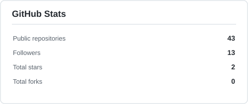
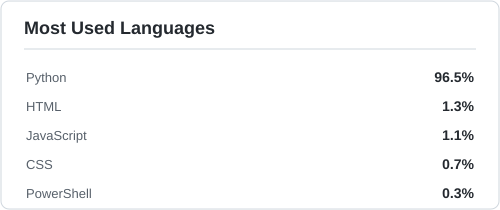
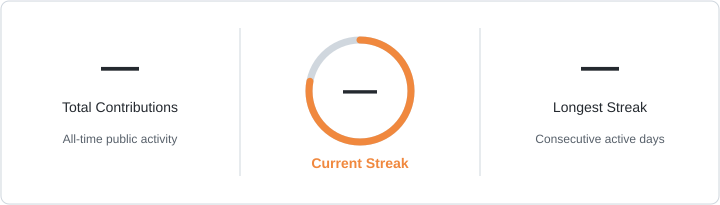

<picture>
  <source media="(prefers-color-scheme: dark)" srcset="assets/dark/header.svg">
  
</picture>

<picture><source media="(prefers-color-scheme: dark)" srcset="assets/dark/s01.svg"></picture>
<picture><source media="(prefers-color-scheme: dark)" srcset="assets/dark/whoami.svg"></picture>

<picture><source media="(prefers-color-scheme: dark)" srcset="assets/dark/s02.svg"></picture>
<picture><source media="(prefers-color-scheme: dark)" srcset="assets/dark/ecosystem.svg"></picture>

<picture><source media="(prefers-color-scheme: dark)" srcset="assets/dark/s03.svg"></picture>
<picture><source media="(prefers-color-scheme: dark)" srcset="assets/dark/projects.svg"></picture>

<picture><source media="(prefers-color-scheme: dark)" srcset="assets/dark/s04.svg"></picture>
<picture><source media="(prefers-color-scheme: dark)" srcset="assets/dark/telemetry.svg"></picture>

### GitHub Stats

<picture>
  <source media="(prefers-color-scheme: dark)" srcset="assets/github-stats-dark.svg">
  
</picture>
<picture>
  <source media="(prefers-color-scheme: dark)" srcset="assets/top-languages-dark.svg">
  
</picture>

### GitHub Contribution Stats

<picture>
  <source media="(prefers-color-scheme: dark)" srcset="assets/contribution-stats-dark.svg">
  
</picture>

### Contribution Activity

<picture>
  <source media="(prefers-color-scheme: dark)" srcset="assets/github-contribution-grid-snake-dark.svg">
  
</picture>

<picture><source media="(prefers-color-scheme: dark)" srcset="assets/dark/s05.svg"></picture>
<picture><source media="(prefers-color-scheme: dark)" srcset="assets/dark/timeline.svg"></picture>
<picture><source media="(prefers-color-scheme: dark)" srcset="assets/dark/experience.svg"></picture>

<picture><source media="(prefers-color-scheme: dark)" srcset="assets/dark/s06.svg"></picture>

### Languages used

  

Python · Java · C · C++ · JavaScript · TypeScript · HTML · CSS

### Frameworks and libraries used

  

Django · React · TensorFlow · PyTorch · OpenCV

### Databases

  

PostgreSQL · MySQL · SQLite

### Tools and others

  

Git · GitHub · Postman · VS Code · Linux

Also exploring: REST APIs · Microservices · Data Structures &amp; Algorithms · System Design

<picture><source media="(prefers-color-scheme: dark)" srcset="assets/dark/footer.svg"></picture>

